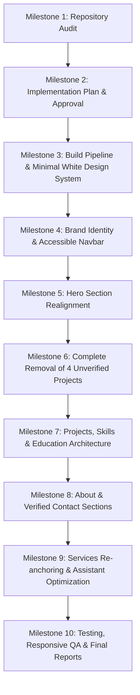

# Portfolio Redesign Implementation Plan

**Brand Name**: Adi Tech Software Solutions (Adi Tech)  
**Target Identity**: Student Developer studying Software Engineering  
**Design Theme**: Minimal, White, Modern, Accessible (WCAG 2.2 AA), Highly Responsive  
**Document**: `docs/implementation-plan.md`  
**Status**: Awaiting User Approval  

---

## 1. Objectives & Guidelines

1. **Authentic Representation**: Present the author truthfully as a Software Engineering student pursuing internships, entry-level roles, mentorship, and project collaborations.
2. **Complete Removal of Unverified Claims**: Permanently purge the 4 unverified highlighted projects, fabricated uptime/submission metrics, arbitrary skill percentages (e.g. 98%), and synthetic SLAs.
3. **Minimal White Aesthetics**: Transform the existing heavy-dark palette into a pristine, modern, high-contrast white aesthetic adhering to the specified design tokens.
4. **Verified Contact & Brand**: Accurately display **Adi Tech Software Solutions**, `aditechsoftwaresolutions@gmail.com`, and `+256 782010327` across all views.
5. **Robust Engineering Quality**: Correct the Vite build pipeline entry point, validate responsive layout across 320px–1440px, ensure WCAG 2.2 AA accessibility, and guarantee clean build execution.

---

## 2. Reviewable Milestones

---

### Milestone 1: Repository Audit (Completed)
- Completed and documented in [docs/portfolio-audit.md](file:///home/adi-tech/Desktop/Portfolio/docs/portfolio-audit.md).
- Discovered critical build issue where `index.html` bypassed Vite bundling by pointing directly to static assets in `assets/`.
- Cataloged all occurrences of the four unverified projects and fabricated claims.

---

### Milestone 2: Implementation Plan Review & Sign-Off (Current Step)
- Present audit findings and proposed sequence of changes to the user for formal approval before modifying application code.
- Clarify handling of remaining student project entries and optional interactive features.

---

### Milestone 3: Build Pipeline Repair & Minimal White Design System
1. **Fix Vite Build Entry**:
   - Update `index.html` to reference ``.
   - Update page title to: `Adi Tech Software Solutions | Student Software Engineer Portfolio`.
   - Update meta tags, descriptions, and keywords to reflect a student developer profile.
2. **Implement Design System Tokens in `tailwind.config.js`**:
   - `background`: `#FFFFFF`
   - `surface-secondary`: `#F4F6F8`
   - `text-primary`: `#172033`
   - `text-secondary`: `#5B6472`
   - `accent-blue`: `#2563EB` (hover: `#1D4ED8`)
   - `border`: `#E5E7EB`
   - `font-sans`: Inter, Plus Jakarta Sans, system-ui
3. **Refactor `src/index.css`**:
   - Replace dark backgrounds (`#090d16`) with white clean backgrounds (`#FFFFFF`).
   - Define clean card styling with subtle borders (`#E5E7EB`) and soft ambient shadows (`box-shadow: 0 1px 3px 0 rgba(0, 0, 0, 0.05), 0 1px 2px -1px rgba(0, 0, 0, 0.05)`).
   - Ensure high text contrast ratios meeting WCAG 2.2 AA across light surfaces.

---

### Milestone 4: Brand Identity & Accessible Navbar
1. **Brand Representation**:
   - Display full brand name **Adi Tech Software Solutions** with clear badge "Student Developer".
   - Use clean, minimal icon branding without mock terminal pings.
2. **Navigation Structure**:
   - Links: **About**, **Skills**, **Projects**, **Education**, **Contact**.
   - Keyboard accessible navigation with visible focus indicators.
   - Mobile-responsive drawer navigation with clear touch targets (min 44×44px).
   - Clean language switcher aligned with student copy.

---

### Milestone 5: Hero Section Realignment
1. **Headline & Copy**:
   - Main headline: *"Software Engineering Student Building Practical Digital Solutions."*
   - Subtitle: *"I'm a student developer studying Software Engineering, exploring modern web technologies, software design, and practical problem-solving through hands-on projects."*
   - Status pill: *"Open to Internships, Entry-Level Roles & Mentorship"*.
2. **Call-to-Action Buttons**:
   - Primary: *"Explore My Projects"* (smooth scroll to `#projects`).
   - Secondary: *"Contact Me"* (smooth scroll to `#contact`).
   - Remove fake CV download script that generates fabricated uptime/submissions metrics.
3. **Visual Showcase**:
   - Replace the fake terminal card (with its mock uptime and `aditech.ug` install script) with a clean, elegant student developer overview card showcasing genuine technical interests, coursework focus, and active learning areas.

---

### Milestone 6: Complete Removal of the Four Unverified Projects
Purge every trace of the four unverified project entries:
1. **`kobo-odk-field-engine`** ("KoboCollect & ODK Central Field Data Sync Engine", 120k+ Submissions, automated Python ETL, GPS polygon verification, PostgreSQL sync, Docker, XLSForm claims).
2. **`aditech-cloud-commander`** ("Aditech Infrastructure Telemetry & Commander", <50ms Latency, real-time telemetry, WebSockets, Chart.js claims).
3. **`network-sentinel-gateway`** ("Aditech Network Sentinel & Secure VPN Gateway", 100% Uptime Record, WireGuard mesh, pfSense, VLAN isolation claims).
4. **`smart-commerce-portal`** ("Next-Gen Enterprise Web Commerce Engine", 99+ Lighthouse, mobile money integrations, enterprise merchant claims).

**Files to update and sanitize**:
- `src/data/projectsData.ts`: Remove entries and claims.
- `src/data/skillsData.ts`: Remove related skills and fabricated percentages.
- `src/components/Hero.tsx`: Remove references in terminal, CV text, and metric counters.
- `src/components/AboutSection.tsx`: Remove references in operational hub and git commits.
- `src/components/ServicesSection.tsx`: Remove references in service descriptions.
- `src/components/AiAssistantWidget.tsx` & `src/utils/aiAssistantBrain.ts`: Purge scripted answers mentioning these projects.
- `src/locales/en.ts`, `fr.ts`, `sw.ts`, `lg.ts`: Purge translations for all 4 projects and claims.
- `index.html`: Remove keywords and metadata.

---

### Milestone 7: Genuine Projects, Skills & Education Architecture
1. **Projects Section (`src/components/ProjectsSection.tsx`)**:
   - Feature genuine student projects with honest attributes:
     - Project Title
     - Problem Solved
     - Personal Contributions / Implementation
     - Technologies Used
     - Development Status (e.g., *In Progress*, *Completed*, *Prototype*)
     - Working GitHub links
     - What was learned / future improvements
   - Provide an authentic empty-state / callout inviting collaborators and allowing easy addition of future verified coursework projects.
2. **Skills Section (`src/data/skillsData.ts` & `src/components/AboutSection.tsx`)**:
   - Categorize genuine student technical domains:
     - Programming Languages (e.g., JavaScript/TypeScript, Python, C/C++ or Java as studied)
     - Frontend Development (React, HTML5, CSS3, Tailwind CSS)
     - Backend & APIs (Node.js, Express, REST APIs)
     - Databases & Tools (SQL/PostgreSQL, Git, GitHub, Linux environment)
     - Computer Science Concepts (Data Structures, Algorithms, Software Design)
   - **Remove all arbitrary percentages** (e.g. 98%, 95%). Replace with descriptive tags (*Proficient*, *Familiar*, *Learning*).
3. **Education Section**:
   - Create a dedicated Education component / card:
     - Title: **Education & Academic Journey**
     - Degree / Study: **Studying Software Engineering**
     - Core Focus: Software design, algorithms, database systems, web development, collaborative engineering.
     - Honest, verified details only (no invented graduation dates or universities).

---

### Milestone 8: About & Verified Contact Sections
1. **About Section**:
   - Narrative highlighting curiosity, commitment to learning, practical problem solving, and collaborative spirit.
   - Remove claims of being an enterprise consultant or operating a 24/7 server lab.
2. **Contact Section & Footer**:
   - Direct clickable email: `mailto:aditechsoftwaresolutions@gmail.com`
   - Direct clickable telephone: `tel:+256782010327`
   - Location: Kampala, Uganda.
   - Contact form with client-side validation, accessible error announcements, and direct email action (no fake success modal or simulated delays).
   - Footer with full brand identity **Adi Tech Software Solutions**, quick navigation links, and student developer disclaimer.

---

### Milestone 9: Services Re-anchoring & Assistant Optimization
1. **ServicesSection Transformation**:
   - Reframe from "commercial vendor services" into **"Areas of Interest & Practical Capabilities"** (e.g., Web Application Development, Scripting & Automation, Linux & System Setup).
2. **AI Assistant Widget**:
   - Reconfigure `aiAssistantBrain.ts` to act as an honest digital portfolio guide answering questions about the student developer's academic focus, projects, and contact channels. Remove claims of corporate pricing ($500–$2500) and enterprise consulting.

---

### Milestone 10: Testing, Responsive QA & Final Reports
1. **Build & Type Checking**:
   - Execute `npm run build` to verify clean TypeScript compilation and Vite bundling without warnings.
2. **Responsive Verification**:
   - Test across viewports: 320px, 375px, 390px, 768px, 1024px, 1440px.
   - Verify zero horizontal overflow, responsive cards, fluid typography, and touch target sizes (≥44px).
3. **Accessibility Verification**:
   - Check color contrast (WCAG 2.2 AA standards).
   - Test keyboard navigation (Tab/Shift+Tab, Enter, Space, Escape).
   - Ensure proper ARIA roles and labels on all interactive controls.
4. **Documentation Deliverables**:
   - Generate `docs/testing-report.md`.
   - Provide comprehensive walkthrough for user review.

---

## 3. Verification & Safety Protocol

- Every git commit will maintain atomic changes.
- Pre-existing files and legitimate assets are preserved.
- No deployment will occur without explicit user consent.
